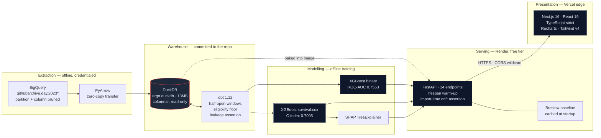

# ARGO — Contributor Survival Intelligence

**Predicts *when* an open-source contributor will go quiet, from 547,434 real GitHub Archive events across 24 production Python repositories.**

##**[Live dashboard](https://argo-lake-phi.vercel.app)** · **[API docs](https://argo-ak57.onrender.com/docs)**

| | |
| --- | --- |
| **Primary model** | XGBoost Cox proportional hazards (`survival:cox`) |
| **Holdout C-index** | **0.7005** — chronological split, never randomised |
| **Cohort** | 3,033 eligible contributors from 77,332 observed |
| **Data** | `githubarchive.day.*` via BigQuery, 2023-07-01 → 2024-01-01 |
| **Stack** | Next.js 16 · FastAPI · DuckDB · dbt 1.12 · XGBoost 3.3 · scikit-survival |
| **Tests** | 7 contract tests · 8 dbt data tests · 1 singular leakage assertion |

---

## The thesis

**The first version of this model scored ROC-AUC 0.97. It was deleted.**

It trained on synthetic events generated by a script in this repository. The generator wrote churn into the data according to a rule; the model recovered the rule. A 0.97 on self-generated data measures nothing but your own function inversion.

The honest replacement scores **0.70**. Everything below explains why that number is worth more, and the engineering required to earn it.

---

## System architecture



**Dependencies flow one way.** Nothing downstream writes upstream. The warehouse has exactly one writer — an offline ETL script — and N readers, all opening the file `read_only=True`.

---

## Why survival analysis

Binary classification asks *will this contributor churn?* and demands a yes/no label for every row. That demand is the flaw.

Of 2,426 training contributors, **1,186 were still active when the observation window closed**. They are **right-censored**: their outcome is unobserved, not negative. A classifier must label them "retained", which is true only up to the cutoff. It cannot express *"still contributing on day 184, outcome unknown."* Nearly half the dataset gets asserted as fact when it is a truncation artifact.

Cox proportional hazards keeps a censored subject in the risk set until the moment of censoring and no further. Nothing fabricated, nothing discarded.

### Label encoding

`survival:cox` takes a single signed target:

```
y = +duration    observed event (contributor lapsed)
y = -duration    right-censored (active at the study cutoff)
```

Emitted by the dbt mart:

```sql
case
    when t.actor_login is null
        then date_diff('day', f.first_event_at, f.last_event_at)   -- lapsed
    else date_diff('day', f.first_event_at, b.target_end)          -- censored
end as duration
```

**Censored subjects must run to `target_end`, not to their last observed event.** Ending the clock early reports a shorter survival time than was observed and biases every hazard estimate downward — silently, with no test failure unless you write one.

`scale_pos_weight` is deliberately absent: the partial likelihood already accounts for censoring through the risk set, so reweighting distorts the hazard rather than balancing anything.

### Harrell's C-index

ROC-AUC needs a hard label at a fixed horizon, which discards every censored subject — exactly the population survival analysis exists for. The concordance index replaces it: *over all comparable pairs, how often does the model rank the one who lapsed first as riskier?* 0.5 is a coin flip.

| | |
| --- | --- |
| Train / holdout | 2,426 / 607, cut chronologically |
| Events / censored (train) | 1,240 / 1,186 |
| Best params | `max_depth=2, min_child_weight=10, n_estimators=100, lr=0.01, subsample=0.8` |
| CV C-index | 0.8522 (3-fold `TimeSeriesSplit`) |
| **Holdout C-index** | **0.7005** |

### The Breslow baseline

`survival:cox` returns a hazard ratio and **nothing else** — no baseline hazard is stored in the artifact, so $P(T>t)$ is not recoverable from `predict()`. Rendering a survival curve without solving this means inventing one.

The API reconstructs it with the Breslow estimator, computed from the **training split only** and cached at startup:

$$d\hat{H}_0(t) = \frac{d(t)}{\sum_{j \in R(t)} \widehat{HR}_j} \qquad S(t \mid x) = S_0(t)^{\widehat{HR}(x)}$$

| Scenario | Hazard ratio | Day 30 | Day 60 | Day 90 | Median survival |
| --- | --- | --- | --- | --- | --- |
| Fading core maintainer | 1.12× | 79% | 64% | 51% | **95 days** |
| Thriving contributor | 0.43× | 91% | 84% | 77% | never (180d+) |

Validation replaces the confusion matrix with **Kaplan-Meier curves stratified by predicted risk tercile**. The bands separate cleanly and never cross — low plateaus near 69% survival, medium near 38%, high near 20%.

---

## Design & architecture tradeoffs

### 1. DuckDB over Postgres

The reflexive answer is "put it in Postgres." It is wrong here, and the reasoning matters more than the verdict.

**This workload has zero write paths.** No `UPDATE`, no interactive transaction, no point lookup by primary key. It runs wide analytical scans — `count(*) FILTER (WHERE event_category = ...)` over half a million rows, grouped by contributor. Precisely what row-stores are worst at.

| Dimension | DuckDB | Postgres |
| --- | --- | --- |
| Storage layout | Columnar, compressed | Row-major heap pages |
| Scanning 6 of 13 columns | Reads 6 | Reads every column in every touched page |
| Execution | Vectorised, SIMD, multi-core by default | Tuple-at-a-time; parallelism opt-in |
| Aggregating 547k rows | **0.05s**, single process | Index strategy, tuning, or a read replica |
| Operational surface | One file | Server, WAL, vacuum, pooling, backups |
| Distribution | Baked into the container image | Managed service, network hop, credential rotation |

Both timings are measured on this warehouse: a six-column grouped aggregate with two `FILTER` clauses returns in 0.05s, and `dbt build` materialises the full training mart — dedupe, windowing, 16 features, both target encodings — in 0.26s, as recorded in `meta_dbt_runs`.

**The concurrency objection is real and does not apply.** Postgres wins decisively on concurrent writers and transactional integrity. This system has one offline writer and N read-only readers. Paying a row-store's scan penalty *plus* operational overhead for MVCC guarantees nothing here requires is a straight loss.

**Portability is the deciding factor, not a consolation.** The 13MB warehouse is committed. A reviewer clones and serves a prediction in under a minute — no database to provision, no credentials, no ETL run. Unavailable from any server-based engine.

**When this flips:** the moment a write path appears — annotations, feedback loops, multi-tenant state. The answer then is Postgres for the OLTP surface *alongside* the columnar store, not migrating analytics into an engine that is bad at it.

### 2. Split hosting — Vercel edge for UI, Render for the ML container

Two workloads with opposite resource profiles. Co-locating them means paying the worse of both.

| | Next.js dashboard | FastAPI + models |
| --- | --- | --- |
| Artifact | Static HTML/JS, a few hundred KB | 2.5GB container |
| Cold start | None — served from CDN edge | Boots image, loads 2 boosters, computes Breslow |
| Scaling unit | Per-request, globally distributed | Per-container, single region |
| Idle cost | Zero | Zero, at `--min-instances 0` |

Putting the dashboard behind the ML container makes every static asset wait on a container that scales to zero. Putting the model on Vercel is not possible — serverless functions cap well below a 2.5GB image with `xgboost`, `shap`, and `scikit-survival` resident.

The seam is one environment variable. `NEXT_PUBLIC_API_URL` points the client at Render; CORS allows all origins because Vercel mints a fresh preview domain per deployment, so the list cannot be enumerated. `allow_credentials` stays **False** — the client sends no cookies and no `Authorization` header, and enabling it alongside a wildcard makes Starlette echo the caller's own origin, letting any site issue credentialed requests for no gain.

The cost is a cold start on the first request after idle. Rather than hide it, the dashboard names it: `ColdStartNotice` stays generic for three seconds, then explains the scale-to-zero tradeoff with an elapsed counter.

### 3. A 2.5GB image that runs in 229MiB — disk and RAM are different problems

The image is 2.5GB. **The running container peaks at 229MiB.** Conflating the two is how services get provisioned at 4× cost.

Measured with every endpoint exercised:

```
after lifespan warm-up   223 MiB
peak, all 14 endpoints   229 MiB
```

**This is what makes a 512MB free tier viable.** Sizing from the image would have ruled Render out on sight and pushed the service onto paid infrastructure it does not need. 229MiB against a 512MB ceiling is a little over 2× headroom — comfortable, and only knowable by measuring.

Disk was attacked separately, and two defects were found by *building* rather than reasoning:

| Defect | Cost | Fix |
| --- | --- | --- |
| `chown -R` after install rewrote every venv file into a new layer | **1.54GB** | `USER` before `uv sync`, `COPY --chown` |
| uv's download cache baked into the sync layer | **~1.8GB** | `UV_NO_CACHE=1` |

**6.93GB → 2.5GB.** The remainder is irreducible without lockfile surgery: `nvidia` CUDA libraries (400MB, pulled by `xgboost`, unused on CPU), `xgboost` (183MB), `llvmlite` (172MB, via `shap`→`numba`), `pyarrow` (152MB).

Image size costs build minutes and cold-start pull time. RAM costs money every second the container is alive. They deserve separate decisions.

---

## Data engineering

### Leakage control

Observation and target windows are declared **once** in a `bounds` CTE and enforced as half-open `[start, end)` intervals. Derived cutoffs are computed from those bounds, never hardcoded, so moving a boundary moves everything downstream.

- **`days_since_last_event` is anchored to `observation_end`, never `max(created_at)`.** Anchoring to the observed maximum makes recency non-comparable across contributors and smuggles future information into an innocent-looking feature.
- **`first_event_at` orders the split and is never a feature.** `enforce_schema` reindexes onto `FEATURE_COLUMNS`, which excludes it.
- **Events are deduplicated on `event_id` via `QUALIFY`** — GitHub Archive replays them.

**Chronological split, never random.** `train_test_split(shuffle=True)` scatters contributors from every era across both sets, so training sees activity contemporaneous with the test set — same release cycles, same CVE scrambles, same conference lulls. The model learns period artifacts and is graded on the period it memorised.

```python
cutoff = int(len(frame) * _SPLIT_RATIO)
train = frame.iloc[:cutoff]   # the earlier cohort
test  = frame.iloc[cutoff:]   # the newest cohort, no temporal adjacency
```

This reproduces the deployment condition: production always scores contributors who arrived after training froze. **Measured cost of honesty: CV 0.8522 → holdout 0.7005.**

### Leakage is asserted, not assumed

`transform/tests/assert_no_target_leakage.sql` recomputes the mart's aggregates from `raw_github_events` restricted to the observation window and fails on any disagreement. It is not a tautology — widening the feature window to `target_end` makes it flag **1,431 of 3,033 rows**.

### The eligibility floor

```sql
having count(*) >= 5
    and count(distinct cast(o.created_at as date)) >= 3
```

The raw cohort is **54,613 contributors at 91.6% churn**, dominated by drive-by first-timers. At that base rate, predicting "everyone churns" scores ~92% precision while knowing nothing.

| Version | Rows | CV | Holdout | Precision | Recall |
| --- | --- | --- | --- | --- | --- |
| `v0.1-synthetic` | 1,000 | — | **0.9700** | — | — |
| `v1.0-github-raw` | 54,613 | 0.7020 | 0.6620 | 0.9269 | 0.8988 |
| `v2.0-eligibility-floor` | 3,033 | 0.8089 | 0.7399 | 0.7609 | 0.6243 |
| `v2.1-regularized` | 3,033 | 0.8131 | 0.7563 | 0.7616 | 0.7238 |
| `v2.2-boundary-probe` | 3,033 | 0.8137 | 0.7553 | 0.7704 | 0.6768 |
| **`v3.0-survival-cox`** | 3,033 | **0.8522** (C) | **0.7005** (C) | n/a | n/a |

**Precision fell 0.9269 → 0.7609 and that was the win.** The old number measured the class distribution. ROC-AUC rose 0.662 → 0.740 over the same change — the metric the base rate was not inflating.

Two rows carry `comparable = false`: `v0.1` scored a different target on data that no longer exists, and a C-index is not an ROC-AUC. Plotting them on one axis would repeat the original error in a new form. The full history lives in `meta_model_registry` and renders in the dashboard.

### Schema drift cannot happen silently

`api/routers/predict.py` asserts at **import time** that the Pydantic request schema matches `FEATURE_COLUMNS` field-for-field. The application refuses to boot on drift. `tests/test_contract.py` asserts the same across the schema, the trained feature list, and the display-label map.

---

## Quick Start

**The warehouse and both trained models are committed.** No credentials, no ETL, no dbt build, no training.

```bash
git clone https://github.com/AarushCh/Argo.git && cd Argo
uv sync
uv run uvicorn api.main:app --reload --port 7860
```

```bash
curl -X POST http://127.0.0.1:7860/api/v1/predict/churn \
  -H 'Content-Type: application/json' \
  -d '{"total_events":41,"distinct_repos":2,"active_days":12,"commit_events":18,
       "pull_request_events":9,"issue_events":7,"comment_events":5,
       "engagement_events":2,"release_events":0,"weekend_ratio":0.08,
       "events_per_active_day":3.4,"tenure_days":96,"days_since_last_event":34,
       "velocity_30d":0.07,"deceleration_score":19,"deceleration_ratio":0.46}'
```

```json
{
  "hazard_ratio": 1.1198,
  "median_survival_days": 95,
  "probability": 0.631,
  "survival_milestones": [
    { "day": 30, "survival": 0.7917 },
    { "day": 60, "survival": 0.6405 },
    { "day": 90, "survival": 0.5083 }
  ]
}
```

Dashboard:

```bash
npm --prefix frontend install
npm --prefix frontend run dev        # http://localhost:3000
```

Container:

```bash
docker build -t argo-backend .
docker run -p 7860:7860 argo-backend
```

### Rebuilding from source

Only needed to change the cohort or the observation windows.

```bash
gcloud auth application-default login
export GOOGLE_CLOUD_PROJECT=<project-id>

uv run python etl/land_github_data.py          # BigQuery → Arrow → DuckDB
cd transform && uv run dbt build --profiles-dir . && cd ..
uv run python -m etl.ingest_dbt_artifacts      # dbt metadata → governance panel
uv run python -m ml.train_classifier           # → churn_xgb.json
uv run python -m ml.train_churn                # → churn_cox.json
uv run python -m ml.evaluate_model             # C-index, KM curves, SHAP
uv run python -m ml.decompose_activity         # STL anomalies
```

---

## Deployment

Both layers deploy from this repository on every push to `main`. Neither needs a CI pipeline of its own — the platforms watch GitHub directly.

| Layer | Platform | Configuration |
| --- | --- | --- |
| API | [Render](https://argo-ak57.onrender.com) · Docker · Free tier, 512MB | Native GitHub integration, builds the root `Dockerfile` |
| Dashboard | [Vercel](https://argo-lake-phi.vercel.app) · Next.js | Native GitHub integration, root directory `frontend` |

**Render** builds the `Dockerfile` at the repository root with no additional configuration. The image is fully self-contained: the DuckDB warehouse and both trained boosters are committed, so there is no build-time extraction, no training step, and no credentials required. `PORT` is injected by the platform and honoured by the container's `CMD`, which falls back to `7860` locally.

**Vercel** needs one environment variable:

| Name | Value | Environments |
| --- | --- | --- |
| `NEXT_PUBLIC_API_URL` | `https://argo-ak57.onrender.com` | Production, Preview, Development |

It is inlined at build time, so changing it requires a redeploy rather than a restart.

**The free tier sleeps after inactivity.** The first request after an idle period pays a cold start while the container boots, loads two boosters, and computes the Breslow baseline. The dashboard surfaces this rather than hiding it — see `ColdStartNotice`.

---

## API surface

| Method | Route | Purpose |
| --- | --- | --- |
| `GET` | `/health` | Liveness probe |
| `GET` | `/api/v1/metrics/executive` | Active contributors, PR/issue throughput, retention |
| `GET` | `/api/v1/metrics/trend` | Monthly active contributors, complete months only |
| `GET` | `/api/v1/metrics/{contributors,throughput,retention}/sparkline` | Trailing 12 complete weeks |
| `GET` | `/api/v1/metrics/activity/decomposition` | STL trend/seasonal/residual + anomalies |
| `GET` | `/api/v1/metrics/governance/health` | dbt test results, build times, row counts |
| `GET` | `/api/v1/customers/risk` | Two-stage triage queue with survival curves |
| `POST` | `/api/v1/predict/churn` | Hazard ratio, survival curve, median, SHAP attribution |
| `GET` | `/api/v1/predict/model-card` | Deployed-model spec, read from artifacts |
| `GET` | `/api/v1/predict/registry` | Full training history |
| `GET` | `/api/v1/predict/simulate/threshold` | Scored holdout for client-side sweeping |
| `GET` | `/api/v1/intelligence/summary` | Executive narrative |

**Two-stage risk ranking.** `/customers/risk` takes the 200 highest-volume contributors, scores them in one batched Cox inference, and returns the 20 with the highest hazard. Ranking the full cohort by hazard surfaces drive-bys the model is confidently right about and no maintainer would action; ranking by volume returns whoever is busiest regardless of risk. The intersection is the only actionable set.

```
contributor      repo                        events  idle      HR   median
vandonr-amz      apache/airflow                 350   39d    1.17      90d
sgugger          huggingface/transformers      1,619   27d    1.04     105d
titaiwangms      pytorch/pytorch                 948   27d    0.99     110d
gmagogsfm        pytorch/pytorch                 393   23d    0.73    180d+
```

---

## Notable findings

**STL recovered the US holiday calendar from raw event volume.** Decomposing daily activity with `period=7` and flagging 3σ residuals — *after* trend and weekly seasonality are removed — surfaces five days across 184:

```
2023-07-04   collapse   z = -3.95    US Independence Day
2023-09-05   collapse   z = -4.16    day after Labor Day
2023-10-18   collapse   z = -3.04
2023-11-24   collapse   z = -4.42    day after US Thanksgiving
2023-12-19   spike      z = +3.70
```

No calendar was supplied to the model.

**Cohort retention is triangular by construction.**

```
Jul 2023   n=16,872   100% → 12.05% → 9.02% → 8.17% → 7.40% → 6.74%
Aug 2023   n=12,918   100% →  8.10% → 5.27% → 4.75% → 3.75%
Sep 2023   n=12,505   100% →  7.66% → 4.77% → 3.89%
Oct 2023   n=12,318   100% →  6.50% → 3.72%
Nov 2023   n=11,837   100% →  5.96%
```

Zero-filling the empty upper-right reports "0% retained" for periods never observed, dragging every recent cohort to the floor. **Absent means unobserved, not churned.**

---

## Repository layout

```
sql/bigquery/      Cost-bounded extraction SQL + cohort/window design doc
etl/               BigQuery → Arrow → DuckDB landing; dbt artifact ingestion
transform/         dbt project, singular leakage test, argo.duckdb (committed)
ml/                Feature contract, Cox + classifier training, evaluation, SHAP, STL
api/               FastAPI routers, lifespan warm-up, Breslow baseline, drift assertion
frontend/          Next.js command suite
tests/             Schema-parity contract tests
```

---

## Known limitations

- **607 holdout rows.** A ±0.02 C-index swing is inside sampling noise. Do not quote 0.7005 as precise.
- **Hyperparameter search has converged.** Two grid expansions moved holdout score by −0.001. Remaining headroom is in the data.
- **Proportional hazards is assumed, not tested.** No Schoenfeld residual analysis has been run. Non-crossing KM terciles are suggestive, not proof.
- **Two models serve one dashboard.** The threshold simulator is probability-based, the triage queue hazard-based. Both honest; the coexistence is not yet explained in the UI.
- **`metric_activity_decomposition` is written by Python, not dbt.** `dbt build` will not rebuild it.
- **CI lints and runs contract tests only.** The dbt leakage test needs a real warehouse and runs locally; synthesising a fixture to make it green would defeat its purpose.
- **Cold-start duration is estimated, not measured.** The dashboard states ~40s as a ceiling. Tune `COLD_START_BODY` once a real Render cold start is observed.

---

## License

[MIT](LICENSE)
