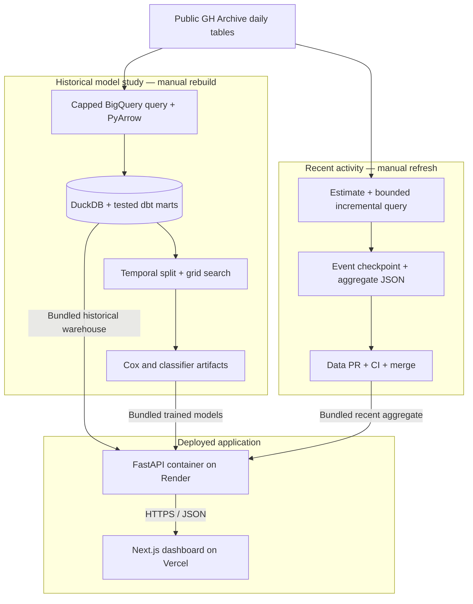
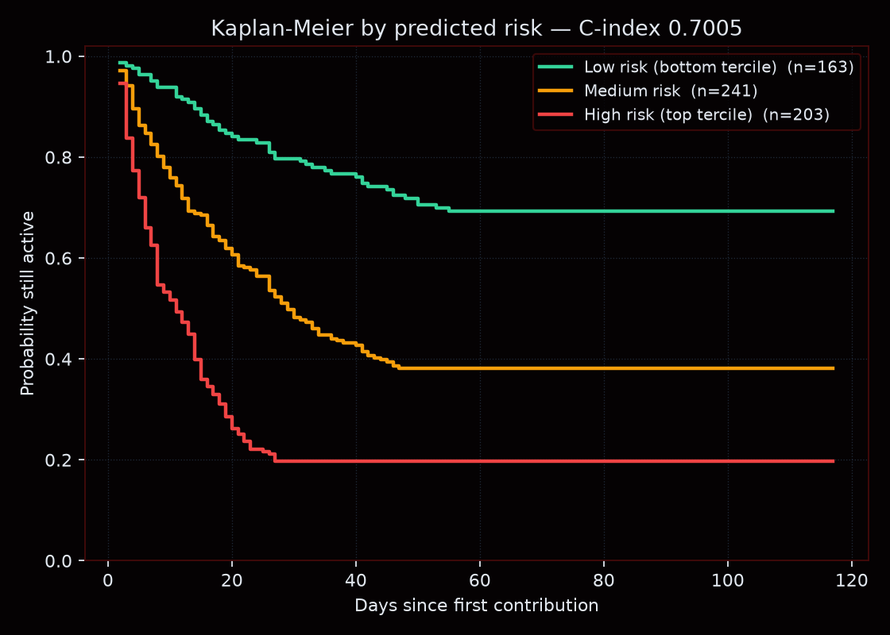
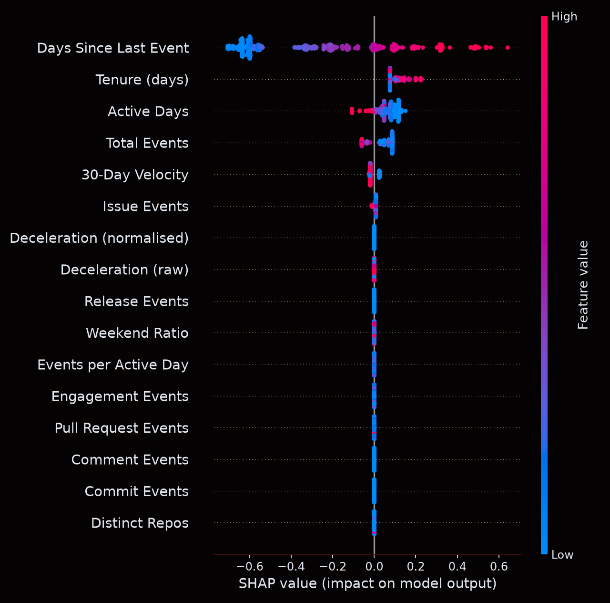
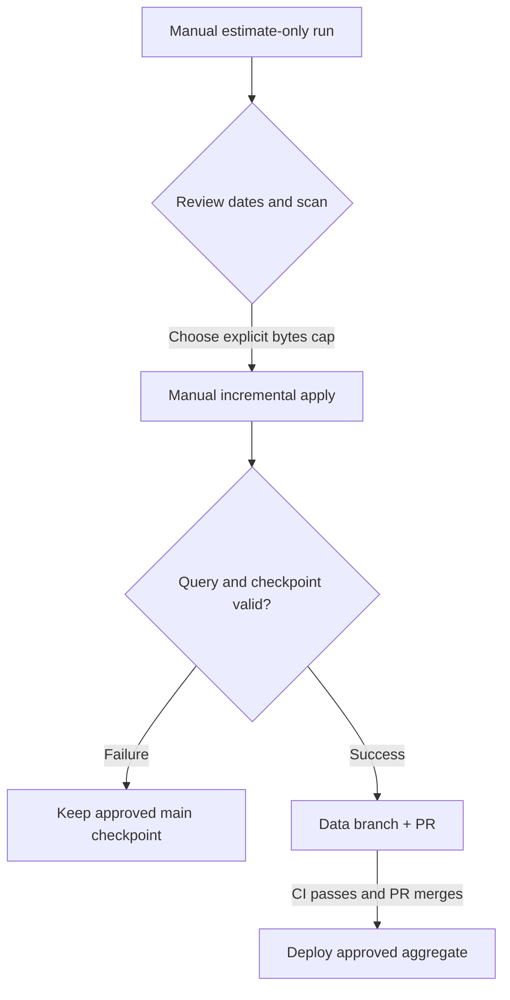

# ARGO — Contributor Survival Intelligence

**A data and ML platform for understanding open-source contributor activity, ranking lapse risk, and inspecting the evidence behind each prediction.**

[](https://github.com/yash-rai-93/argo-data-platform/actions/workflows/ci.yml)
[](pyproject.toml)
[](frontend/package.json)
[](LICENSE)

**[Live dashboard](https://argo-data-platform.vercel.app/) · [Interactive API docs](https://argo-api-yash.onrender.com/docs) · [Releases](https://github.com/yash-rai-93/argo-data-platform/releases) · [Deployment guide](docs/DEPLOYMENT.md)**

ARGO connects public GitHub Archive events, a tested DuckDB/dbt warehouse, two XGBoost models, and a Next.js dashboard. It gives maintainers and developer-relations teams a way to inspect participation trends, review established contributors with elevated model risk, and explore how activity patterns affect a prediction.

| At a glance | Verified implementation |
| --- | --- |
| Historical source | **547,434 real events** across **24 Python repositories** |
| Eligible modelling cohort | **3,031 contributors**, with **16 behavioural features** |
| Primary survival result | **0.7063 holdout C-index** |
| Companion classifier result | **0.7608 holdout ROC-AUC** |
| Evaluation | Entry-date-ordered 80/20 split; 3-fold expanding-window CV |
| Validation | **39 Python tests**, **8 dbt data tests**, frontend and container checks |
| Recent activity | Manually triggered incremental refreshes with an explicit query cap |

**Two data paths are deliberately separate.** Model training, benchmarks, the retention queue, and historical charts use the fixed **July–December 2023 study**. The recent-activity panel uses its own approved snapshot and displays its coverage and update time. Refreshing recent activity does **not** retrain the models or establish their accuracy on current contributors.

[Features](#what-you-can-do) · [Architecture](#architecture) · [Results](#measured-results) · [Data and models](#data-and-modelling) · [Quick start](#quick-start) · [Refresh workflow](#manual-incremental-refresh) · [API](#api) · [Roadmap](#limitations-and-next-iterations)


**Stack:** Python 3.12 · FastAPI · DuckDB · dbt · XGBoost · scikit-survival · SHAP · Next.js 16 · React 19 · TypeScript · Tailwind CSS 4 · Recharts · GitHub Actions.

## What you can do

| Capability | What the application provides |
| --- | --- |
| **Explore contributor health** | Active contributors, PR/issue throughput, retention, monthly trends, and weekly sparklines anchored to the historical dataset. |
| **Review recent activity** | Real event counts, unique contributors, PR/issue events, daily activity, and explicit freshness from a manually refreshed snapshot. After 14 covered days, compare consecutive seven-day periods and inspect repository/category drivers. |
| **Prioritize a retention review** | Select the 200 highest-volume eligible contributors, score them in one Cox batch, and show the 20 highest predicted hazards with survival curves. |
| **Run prediction scenarios** | Submit 16 features to receive classifier probability, relative hazard, a study-time survival curve, and SHAP contributions. |
| **Explore threshold tradeoffs** | Sweep the classifier threshold against the cached **607-row holdout** and inspect the resulting confusion matrix. |
| **Inspect evidence and lineage** | View model specifications, recorded experiments, dbt build/test metadata, source windows, and STL activity anomalies. |
| **Export a review** | Download the retention or ML workspace as a PDF report. |
| **Read an activity summary** | Generate a narrative directly from stored metrics; optionally enable an OpenRouter model with explicit backend configuration. |

The retention queue supports human investigation. An absence of events in the selected repositories is a scoped activity signal; it does not explain a contributor's intentions or prove they have left open source.

## Architecture

### Data, training, and serving



The runtime is self-contained. It reads the historical warehouse in read-only mode, loads the committed model files, and serves the promoted recent-activity aggregate. It needs **no GCP credentials, remote database, or event extraction to answer a dashboard request**.

### Prediction path

1. **Validate the feature contract.** Pydantic validates the request; the shared feature schema fixes names and ordering across training and serving.
2. **Score both models.** The classifier returns a churn-label probability. The Cox booster returns a relative hazard.
3. **Construct the curve.** A cached Breslow baseline, estimated from the **training split only**, converts the hazard into a survival curve.
4. **Explain the classifier.** SHAP TreeExplainer returns all 16 contributions in log-odds space and the three largest absolute contributors.
5. **Render the decision view.** The dashboard shows probability, hazard, curve, milestones, and threshold tradeoffs as distinct outputs.

The per-request SHAP explanation belongs to the **binary classifier**. The exported evaluation SHAP plot below belongs to the **Cox model**.

### Engineering choices

| Choice | Why it fits this implementation |
| --- | --- |
| **DuckDB + dbt** | One offline writer, analytical scans, tested transformations, and a portable warehouse bundled with the application. A managed transactional database is unnecessary for the current read-only product. |
| **Separate frontend and API** | The Next.js interface and Python ML runtime deploy independently; the frontend points to the API through one public build-time setting. |
| **Cached model helpers** | Model loading, classifier SHAP structures, training-only baseline estimation, and holdout scores are reused within the API process. |
| **Committed matched artifacts** | A clone can serve the demo without running an extraction or training job. The warehouse, models, parameter files, and evaluation charts have a provenance manifest. |
| **Manual refresh and review** | BigQuery usage occurs only when an operator triggers it. A data PR makes the new checkpoint and coverage reviewable before deployment. |
| **GitHub OIDC federation** | Extraction uses short-lived Google credentials with repository/workflow restrictions rather than a committed service-account key. |

## Measured results

The current matched historical artifacts were produced by [rebuild 39998805393](https://github.com/yash-rai-93/argo-data-platform/actions/runs/39998805393). Model settings and scores are stored in [Cox parameters](ml/models/churn_cox_params.json), [classifier parameters](ml/models/churn_xgb_params.json), and the warehouse registry. [argo-artifacts.json](argo-artifacts.json) records their source commit, study window, and SHA-256 checksums.

| Model | Task | Cross-validation | Held-out result |
| --- | --- | --- | --- |
| **XGBoost Cox** (`survival:cox`) | Rank contributor lapse risk with censoring-aware targets | **0.8517 C-index** | **0.7063 C-index** |
| **XGBoost classifier** (`binary:logistic`) | Predict no activity in the target window | **0.8153 ROC-AUC** | **0.7608 ROC-AUC** |

The classifier's default-threshold holdout results were **0.7620 precision**, **0.6989 recall**, and **0.6903 accuracy**. Both models use **2,424 training rows / 607 holdout rows**. The Cox training split contains **1,243 observed lapse labels and 1,181 right-censored rows**.

**C-index and ROC-AUC measure different tasks.** A C-index of 0.7063 describes risk ordering among comparable survival pairs; it is not 70.63% classification accuracy. The CV-to-holdout gap is reported rather than hidden, and neither score establishes performance on the separate recent-activity snapshot.

| Selected parameter | Cox | Classifier |
| --- | --- | --- |
| Trees | 100 | 100 |
| Maximum depth | 2 | 2 |
| Learning rate | 0.01 | 0.05 |
| Minimum child weight | 5 | 5 |
| Subsample | 0.6 | 0.6 |

Each trainer searches **48 parameter combinations across three folds** (144 CV fits), uses CPU histogram trees and a fixed seed of 42. The classifier's class weight is computed from training labels only.

### Evaluation artifacts

**Survival evaluation:** Kaplan–Meier curves for the holdout, grouped by predicted Cox risk.



**Cox feature attribution:** SHAP summary over the held-out feature matrix.



Both figures are generated by [ml/evaluate_model.py](ml/evaluate_model.py) from the committed historical study.

### Experiment progression

Earlier recorded experiments explain how the modelling problem changed. They are historical results on their own cohorts, not a controlled leaderboard against the current rebuild.

| Stage | Contributors | Holdout metric | Change |
| --- | --- | --- | --- |
| Synthetic SaaS prototype | 1,000 | 0.9700 ROC-AUC | Different generated data and target; **not comparable** to GitHub results. |
| Raw GitHub cohort | 54,613 | 0.6620 ROC-AUC | Established a real-data reference dominated by brief participation. |
| Eligibility floor | 3,033 | 0.7399 ROC-AUC | Required at least five events across three active days. |
| Trajectory + regularization | 3,033 | 0.7563 ROC-AUC | Added velocity/deceleration signals and shallow trees. |
| Expanded classifier search | 3,033 | 0.7553 ROC-AUC | Tested a wider grid; no holdout improvement in that experiment. |
| Current rebuilt classifier | 3,031 | **0.7608 ROC-AUC** | Reproduced the current feature/window implementation. |
| Current rebuilt Cox model | 3,031 | **0.7063 C-index** | Added a survival task; its metric is not directly comparable to ROC-AUC. |

Recorded history is defined in [ml/model_registry.py](ml/model_registry.py) and served through the model-registry endpoint. The 3,033-row experiments and 3,031-row rebuild have different cohorts; their small score differences should not be presented as isolated model gains.

## Data and modelling

### Study definition

| Component | Definition |
| --- | --- |
| Source | Public GH Archive events queried through BigQuery; curated Python repositories; listed bot accounts and bot-pattern logins filtered out. |
| Historical extract | `[2023-07-01, 2024-01-01)`, spanning observation and target periods. |
| Feature window | `[2023-07-01, 2023-11-01)`. |
| Target window | `[2023-11-01, 2024-01-01)`. |
| Eligible contributor | At least **5 events** on at least **3 distinct active days** in the feature window. |
| Churn label | No observed event in the scoped repositories during the target window. |
| Holdout ordering | Sort by `first_event_at`, with `actor_login` as a tie-breaker; train on the first 80%, evaluate on the remaining 20%. |
| Model selection | Three expanding-window folds over the ordered training rows; the holdout is excluded from fitting and grid search. |

The SQL uses half-open date intervals so an event at a boundary belongs to one window. This is an **entry-date-ordered cohort split within one historical study**, not a rolling calendar backtest across multiple future periods.

### Feature contract

The shared [16-feature schema](ml/feature_extractor.py) is used by dbt outputs, model training, evaluation, and API inference.

| Feature group | Fields |
| --- | --- |
| Volume and breadth | `total_events`, `distinct_repos`, `active_days` |
| Activity mix | `commit_events`, `pull_request_events`, `issue_events`, `comment_events`, `engagement_events`, `release_events` |
| Cadence and recency | `weekend_ratio`, `events_per_active_day`, `tenure_days`, `days_since_last_event` |
| Trajectory | `velocity_30d`, `deceleration_score`, `deceleration_ratio` |

`velocity_30d` is the share of observed events in the final 30 feature-window days. Deceleration compares activity in the two halves of that window. Recency is anchored to the **observation cutoff**, and the entry timestamp used for splitting is excluded from the model features.

### Survival target and interpretation

The dbt mart encodes a lapse when no target-window activity is observed. Its duration is measured from the first observed event to the last feature-window event for lapse labels, or to the study cutoff for censored rows. XGBoost receives positive durations for observed events and negative durations for censoring.

The API estimates a baseline survival function from training risk sets and applies:

$$
S(t \mid x) = S_0(t)^{HR(x)}
$$

Curves cover a **0–180 day study-time grid**. `median_survival_days` is the first grid point where estimated survival reaches 50%; `null` means it does not reach that threshold within the grid. These are retrospective study-time estimates, **not a calibrated countdown from today** or a guarantee of when a person will stop contributing.

### Data quality and governance

- Deduplicate historical events by immutable `event_id` before building features.
- Keep feature and outcome windows disjoint; use a singular dbt test to recompute feature aggregates and check boundary/target consistency.
- Assert agreement between API request fields, training feature order, model feature lists, and display labels.
- Ingest dbt's `run_results.json` into governance tables instead of maintaining a separate hand-written health status.
- Record model settings, evaluation results, source windows, and artifact checksums for review and reproduction.
- Decompose historical daily activity with STL and a weekly period; flag residuals beyond three standard deviations. These flags identify unusual volume, not its cause.

## Manual incremental refresh

Recent activity refreshes are **on demand**. There is no weekly/hourly schedule, no background polling, and no BigQuery query triggered by a visitor.



| Guardrail | Behaviour |
| --- | --- |
| First load | Seven recent days, without filling the gap from the 2023 study. |
| Subsequent loads | Resume from the approved cursor and re-read two days for late arrivals. |
| Deduplication | Upsert by stable event ID; retain up to 90 covered days. |
| Bounded catch-up | At most 31 daily source tables per run; long gaps require successive approved batches. |
| Publication lag | Leave yesterday and the current UTC day unqueried. |
| Spending control | Estimate first; apply requires an explicit cap of at most **20 GB** and rejects an estimate above it. |
| Recovery | Failed runs do not approve a new cursor; pending data branches block another query until resolved. |
| Deployment | Promote the checkpoint and checksum-verified aggregate together through a data PR. Only the aggregate ships in the API image. |

**Verified first refresh:** [run 40009513670](https://github.com/yash-rai-93/argo-data-platform/actions/runs/40009513670) covered **October 15–21, 2026 UTC**, fetching **1,050 events**, **344 contributors**, and **442 PR/issue events**. BigQuery reported **326,575,749 processed bytes** and **327,155,712 billed bytes**, below the explicit **400,000,000-byte cap**. These are usage measurements, not an invoice or a recurring price.

For current coverage, inspect [data/recent-activity.json](data/recent-activity.json) or [the recent-activity API](https://argo-api-yash.onrender.com/api/v1/activity/recent). The first-refresh numbers above are a dated execution record.

**To refresh:** open **Actions → Data maintenance (manual)** on `main`, run `incremental-dry-run`, review its exact dates, then run `incremental-refresh` with the chosen cap and exclusive end date. Review and merge the resulting `data/manual-refresh` PR. Full instructions and failure recovery are in [docs/MANUAL_REFRESH.md](docs/MANUAL_REFRESH.md).

Query caps apply to the data query, not the entire billing account. Applicable credits/free allowances, data transfer, Actions usage, and hosting/build limits determine actual costs. Historical retraining remains a separate manual operation.


### Weekly changes and snapshot quality

A bounded **28-day backfill** can extend the first recent snapshot; later manual
refreshes retain up to 90 days. The dashboard compares the latest seven covered
UTC days with the preceding seven only when both are fully covered. It reports
event and contributor changes, returning/joining/absent contributors, and
exhaustive repository/event-category event deltas. Joining means absent from the
previous period, not new to open source; absence does not establish churn.

New snapshots record daily source coverage, incoming duplicate IDs, checkpoint
overlap, validation results, and provenance. Data age is shown separately from
validity. Older snapshots show unrecorded checks explicitly. Reading every
expected GH Archive table verifies query coverage, not capture of every GitHub
event.

See the [28-day activity investigation](docs/investigations/activity-concentration.md).
Its matched September 24–October 21, 2026 snapshot contains **5,657 events** and
**1,116 contributors**. The latest week's event count fell **34.62%**, while
PR/issue-category events rose **4%**; the report examines repository drivers and
single-account concentration. It records its exact checksum and reproduction
steps, and makes no causal or current-model-performance claim.

## Quick start

**Prerequisites:** Git, Python 3.12 managed with [uv](https://docs.astral.sh/uv/), and Node.js 22 for the dashboard. Docker is optional.

The repository includes its public historical warehouse, both trained models, and the approved recent aggregate. Running the demo locally requires **no cloud credentials, data extraction, or model training**.

### 1. Start the API

```bash
git clone https://github.com/yash-rai-93/argo-data-platform.git
cd argo-data-platform
uv python install 3.12
uv sync --frozen
uv run uvicorn api.main:app --reload --port 7860
```

Open [localhost:7860/docs](http://localhost:7860/docs) for Swagger UI, or call `GET /health`.

### 2. Start the dashboard in a second terminal

From the repository root:

```bash
cd frontend
npm ci
npm run dev
```

Open [localhost:3000](http://localhost:3000). The default API origin is `http://localhost:7860`.

### 3. Or run the API container

From the repository root:

```bash
docker build -t argo-backend .
docker run --rm -p 7860:7860 argo-backend
```

The image contains the warehouse and model artifacts, runs as a non-root user, and honors `PORT` with a default of `7860`.

## API

All application routes are public. Runtime analytics read local artifacts; prediction requests run the committed models.

| Method | Route | Purpose |
| --- | --- | --- |
| `GET` | `/health` | Liveness. |
| `GET` | `/api/v1/activity/recent` | Promoted recent aggregate, coverage, freshness, and query provenance. |
| `GET` | `/api/v1/metrics/executive` | Historical contributor, throughput, and retention KPIs. |
| `GET` | `/api/v1/metrics/trend` | Complete-month contributor trend. |
| `GET` | `/api/v1/metrics/{contributors,throughput,retention}/sparkline` | Historical weekly activity/retention series; each name identifies a separate route. |
| `GET` | `/api/v1/metrics/activity/decomposition` | STL components and residual anomaly flags. |
| `GET` | `/api/v1/metrics/governance/health` | dbt runs, tests, source coverage, and model row counts. |
| `GET` | `/api/v1/customers/risk` | Prioritized historical contributor queue with Cox curves. |
| `POST` | `/api/v1/predict/churn` | Classifier probability, hazard, survival curve, and classifier SHAP attribution. |
| `GET` | `/api/v1/predict/model-card` | Classifier artifact settings and historical cohort metadata. |
| `GET` | `/api/v1/predict/registry` | Recorded model experiments, with metric comparability flags. |
| `GET` | `/api/v1/predict/simulate/threshold` | Cached classifier holdout scores and labels. |
| `GET` | `/api/v1/intelligence/summary` | Historical metric summary with an optional configured LLM provider. |

**Example request:** this illustrative feature vector is a manual scenario, not a newly fetched contributor.

```bash
curl -X POST http://localhost:7860/api/v1/predict/churn \
  -H "Content-Type: application/json" \
  -d '{"total_events":41,"distinct_repos":2,"active_days":12,
       "commit_events":18,"pull_request_events":9,"issue_events":7,
       "comment_events":5,"engagement_events":2,"release_events":0,
       "weekend_ratio":0.08,"events_per_active_day":3.4,"tenure_days":96,
       "days_since_last_event":34,"velocity_30d":0.07,
       "deceleration_score":19,"deceleration_ratio":0.46}'
```

The response includes `probability`, `hazard_ratio`, `survival_curve`, `survival_milestones`, `median_survival_days`, `shap_attribution`, and `top_factors`. The classifier probability and Cox hazard come from separate models and should not be interpreted as interchangeable scores.

## Deployment and configuration

| Component | Configuration |
| --- | --- |
| **Frontend** | Vercel Next.js project rooted at `frontend/`; Node 22; `npm ci` and `npm run build`. |
| **Backend** | Render Docker web service from the repository root; [render.yaml](render.yaml) selects the Free plan in Singapore and waits for checks before deploying. |
| **API origin** | Set frontend `NEXT_PUBLIC_API_URL=https://argo-api-yash.onrender.com`, without `/api/v1` or a trailing slash. It is compiled into browser JavaScript, so changes require a frontend rebuild. |
| **Extraction identity** | GitHub repository variables `GCP_PROJECT_ID`, `GCP_ETL_SERVICE_ACCOUNT`, and `GCP_WORKLOAD_IDENTITY_PROVIDER`; short-lived OIDC credentials. |
| **Optional summaries** | Set both backend `OPENROUTER_API_KEY` and `OPENROUTER_MODEL` to enable provider calls. Otherwise the summary is generated directly from stored metrics. |
| **Runtime secrets** | No GCP credentials are needed for serving. Provider secrets, if enabled, stay on the backend. |

The configured backend can sleep while idle; the dashboard includes a cold-start notice. Its displayed timing is an estimate, not a measured startup guarantee. CORS permits public preview origins without credentialed requests.

See [the deployment runbook](docs/DEPLOYMENT.md) for full setup, GCP permissions, historical reproduction, and rollback. [.env.example](.env.example) lists local extraction/provider settings; use `uv run --env-file .env ...` when loading that file.

### CI/CD and reproducibility

| Workflow | Trigger and checks |
| --- | --- |
| **CI** | Main pushes and PRs: Ruff format/lint, 39 Python tests, recent-checkpoint validation, dbt build with 8 data tests, SQL lint, frontend lint/build, maintenance-workflow syntax/ShellCheck, and container API smoke under **512 MiB / 1 CPU**. |
| **Data maintenance (manual)** | Estimate/apply recent increments, or estimate/rebuild the full historical artifact set. An ordinary push does not query BigQuery or retrain models. |
| **Verify live deployment** | Manual verification of the hosted API, prediction response, frontend API origin, HTTP responses, and CORS. |
| **Publish container** | Manual or `v*` tag trigger; build and smoke-test the image before publishing to `ghcr.io/yash-rai-93/argo-backend`. Images are available when the publishing workflow completes successfully. |

Container smoke checks demonstrate that the tested route set completes within the configured resource limit. They are **not** a sustained-load, peak-memory, latency, or concurrency benchmark.

From the repository root:

```bash
uv run ruff format --check .
uv run ruff check .
uv run pytest
uv run python -m etl.refresh_activity --validate-only

# Requires the local API to be running
uv run python -m api.smoke_test
```

The normal development/test path uses committed data and makes no BigQuery extraction or optional LLM provider call.

## Repository map

| Path | Responsibility |
| --- | --- |
| [sql/bigquery/](sql/bigquery/) | Historical and recent extraction SQL. |
| [etl/](etl/) | BigQuery landing, incremental checkpoints, and dbt metadata ingestion. |
| [transform/](transform/) | Committed DuckDB warehouse, dbt models, source checks, and leakage assertion. |
| [ml/](ml/) | Shared features, classifier/Cox training, registry, evaluation, summaries, and decomposition. |
| [ml/models/](ml/models/) | Matched trained models and parameter metadata. |
| [api/](api/) | FastAPI routers, inference helpers, and smoke tests. |
| [frontend/](frontend/) | Next.js dashboard, prediction/retention views, and PDF export. |
| [data/](data/) | Approved recent-activity aggregate and compressed cursor/event state. |
| [tests/](tests/) | Feature contracts, extraction limits, summaries, refresh recovery, and recent API tests. |
| [.github/workflows/](.github/workflows/) | CI, manual data maintenance, live verification, and image publishing. |

## Limitations and next iterations

- **Outcome and time definition.** Lapse is inferred from absence in selected repositories over a fixed window. Current survival durations are a retrospective proxy; a future iteration should define an operational inactivity threshold, landmark the prediction time, and evaluate remaining-time estimates prospectively.
- **Generalization and calibration.** Results come from one historical study and 607 holdout contributors. Add rolling calendar backtests, confidence intervals, probability/survival calibration checks, censoring-aware alternatives such as IPCW concordance, and proportional-hazards diagnostics before claiming current-population accuracy.
- **Serving capacity.** The demo has public endpoints and a sleeping backend. Add rate limits, structured operational metrics, measured cold-start and load tests, and caching based on those measurements before increasing traffic.
- **Refresh persistence.** The working checkpoint retains 90 days, but each approved refresh adds Git history. Move state to object storage with versioning and locking before introducing frequent automated ingestion; late arrivals older than the two-day overlap also need an explicit repair path.
- **Product polish.** Improve small-screen tab navigation and add automated browser assertions for freshness, artifact-version agreement, and the complete refreshed-data path.

## Documentation and references

- [Deployment, historical rebuild, and rollback](docs/DEPLOYMENT.md)
- [Manual incremental refresh and recovery](docs/MANUAL_REFRESH.md)
- [Historical artifact provenance](argo-artifacts.json)
- [BigQuery cohort/query notes](sql/bigquery/README.md)
- [GH Archive](https://www.gharchive.org/)
- [XGBoost Cox objective](https://xgboost.readthedocs.io/en/release_3.3.0/parameter.html)
- [Interpreting survival-model evaluation](https://scikit-survival.readthedocs.io/en/latest/user_guide/evaluating-survival-models.html)

## License

Source code is available under the [MIT License](LICENSE). Public activity comes from GH Archive; source attribution and study dates are recorded separately from the code license.

Maintained by [Yash Rai](https://github.com/yash-rai-93).
