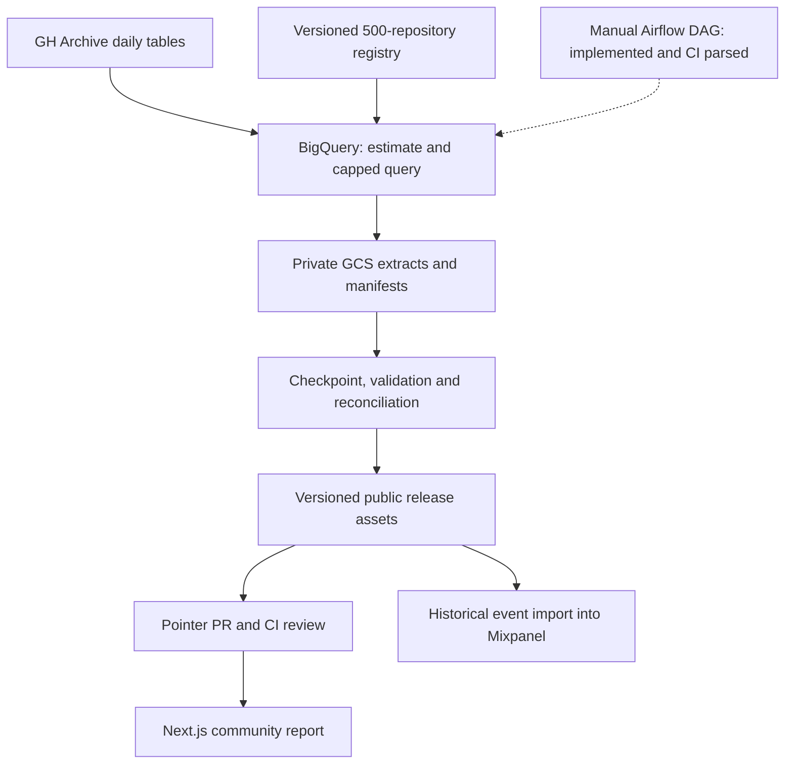
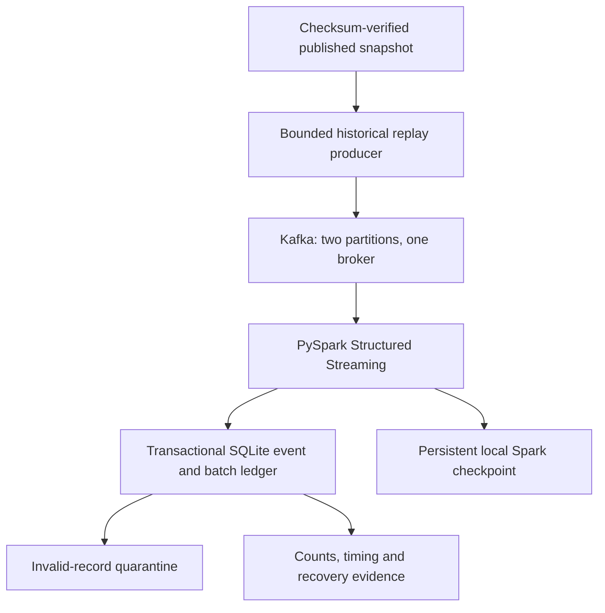

# ARGO — GitHub Activity Data Platform

**A data engineering and analytics platform that turns public GitHub events into verified participation reports, with resumable cloud ingestion, reviewed publication, and a tested Kafka/PySpark replay pipeline.**

[](https://github.com/yash-rai-93/argo-data-platform/actions/workflows/ci.yml)
[](pyproject.toml)
[](LICENSE)

**[Community report](https://argo-data-platform.vercel.app/community) · [ML dashboard](https://argo-data-platform.vercel.app/) · [Mixpanel analysis](https://mixpanel.com/project/4028794/app/boards#id=11608511) · [API docs](https://argo-api-yash.onrender.com/docs) · [Operational evidence](docs/OPERATIONAL_EVIDENCE.md)**

ARGO answers a practical question: **when repository activity changes, is participation changing too, and can we trust the data behind that conclusion?** It combines a bounded BigQuery/GCS pipeline, exact event-level analysis, a three-page community dashboard, and a separate historical contributor-risk study.

## Project at a glance

| Area | Verified result |
| --- | --- |
| Expanded scope | **500 versioned repository IDs**, with observed events in **421** |
| Published community dataset | **94,133 unique events**, **27,936 distinct accounts**, **41,432 PR/issue events** |
| Coverage | **90 UTC days: July 25–October 22, 2026**, across 13 verified backfill batches |
| Query usage | **15,537,799,168 billed bytes** against a **20,000,000,000-byte backfill cap** |
| Mixpanel reconciliation | All **94,133 contributor events** imported; totals and participation findings reconciled |
| Streaming sandbox | Real Kafka + PySpark integration, transactional deduplication, quarantine and checkpoint recovery |
| Replay measurements | **706.643 records/s median** across three 1,000-record CI trials; **1.335 s** controlled recovery |
| Historical ML study | **547,434 events**, 24 repositories, 3,031 eligible contributors; **0.7063 holdout C-index** |

Community figures describe the [pinned release](https://github.com/yash-rai-93/argo-data-platform/releases/tag/community-data-40112298324-1), refreshed **October 24, 2026 at 16:36 UTC**. They are a dated snapshot, not a claim of current GitHub activity. Query bytes measure usage, not INR expenditure.

**Stack:** Python 3.12 · BigQuery · Google Cloud Storage · Apache Airflow 3.3.2 · Apache Kafka 4.2.1 · PySpark 3.5.6 · SQLite · DuckDB · dbt · FastAPI · Next.js 16 · TypeScript · Mixpanel · XGBoost · GitHub Actions.

[Architecture](#architecture) · [Engineering](#pipeline-engineering) · [Analysis](#analytics-and-mixpanel-findings) · [Evidence](#operational-evidence) · [Quick start](#quick-start) · [Runbooks](#runbooks-and-repository-map)

## Architecture

### Cloud batch ingestion and publication



Cloud backfill and publication have execution evidence. Incremental ingestion and the Airflow DAG are implemented and tested; the first advancing cloud incremental apply and a deployed Airflow scheduler still need verification. Publication remains an explicit review step.

### Kafka/PySpark replay sandbox



Replay preserves original GitHub timestamps and adds separate publication metadata. The consumer runs in bounded `availableNow` mode and exits. This is a tested streaming implementation using historical input; it is not a continuously deployed live GitHub feed. The single-driver SQLite sink and single Kafka broker are deliberate pilot limits.

The separate **2023 study** follows BigQuery → DuckDB/dbt → XGBoost → FastAPI → the ML dashboard. Updating the community report does not retrain those models.

## Pipeline engineering

| Concern | Implementation |
| --- | --- |
| **Stable scope** | The [repository registry](config/repository-scope-v1.json) pins 500 IDs, canonical names and discovery provenance. Queries use IDs to tolerate renames. |
| **Resumable backfill** | Thirteen bounded windows cover 90 days. GCS generation preconditions protect checkpoints; pinned job IDs allow reattachment instead of blindly repeating paid queries. |
| **Cost controls** | Estimate before apply; explicit per-query and execution byte caps; persist the full reservation before submission; account for failed attempts before permitting an explicit retry. |
| **Incremental ingestion** | Two-day overlap plus up to five new days per query; retain 90 continuous UTC days. Accept late additions in the overlap, deduplicate IDs, and reject changed payloads for existing IDs. |
| **Data contracts** | Validate schema, UTC boundaries, repository scope, category mapping, counts, unique IDs and compressed-file SHA-256 checksums. Write manifests only after successful uploads. |
| **Safe promotion** | Recompute aggregates before publication. Keep large snapshots in versioned release assets and commit a small checksum-pinned pointer. Reject stale predecessor states. |
| **Failure recovery** | Failed validation preserves the approved report. Completed executions reuse stored outputs. Arrivals older than the overlap need explicit repair. |
| **Orchestration** | Airflow runs prepare → estimate → optional ingest → candidate verification, with pinned inputs, bounded timeouts, one active run and small XCom receipts. It holds no GitHub write token. |
| **Streaming correctness** | At-least-once production; event-ID deduplication, Kafka-offset fingerprints, atomic event/batch ledger commits, malformed-record quarantine and conflict rollback. |
| **Identity** | GitHub OIDC/Workload Identity Federation supplies short-lived extraction credentials. GCS stays private; public releases contain the approved public event fields. |

The 500 repositories are a purposive, popularity-biased sample selected from eight searches, not a representative census of open source. Account exclusions are heuristics; retained accounts are not guaranteed to be human.

### Implementation and deployment status

| Component | Evidence and current boundary |
| --- | --- |
| BigQuery → GCS backfill | [Completed cloud run](https://github.com/yash-rai-93/argo-data-platform/actions/runs/40110018483); all 13 batches reconciled |
| Community report | Published at [`/community`](https://argo-data-platform.vercel.app/community); source pinned by [data/community-source.json](data/community-source.json) |
| Incremental controller | Implemented and tested; [first dry run](https://github.com/yash-rai-93/argo-data-platform/actions/runs/40120989631) correctly returned a no-op; advancing apply still unverified |
| Airflow | Real Airflow SDK parses the DAG in CI; scheduler/runtime deployment remains pending |
| Kafka/PySpark | Real broker/connector replay and recovery pass in CI; no always-on cloud deployment |
| Mixpanel | Three analysis boards, five embedded native reports and additional interactive query links; requires project access |
| Power BI | Being built separately; no published Power BI dashboard is claimed here |

## Analytics and Mixpanel findings

The [community report](https://argo-data-platform.vercel.app/community) supports date, repository and event-category filters. Distinct accounts are recomputed from matching events rather than summed across days or repositories.

| Report | Questions and visuals |
| --- | --- |
| **Community Overview** | Event/account/PR-issue KPIs, aligned daily trends, repository ranking and category drivers of weekly change |
| **Participation & Concentration** | Returning/joining/absent accounts, observed cohort returns, top-account shares and event growth versus contributor growth |
| **Data Trust & Pipeline Health** | Coverage, freshness, validation, duplicate checks, provenance and query bytes versus caps; incremental reconciliation when recorded |

The same approved snapshot was imported into **Mixpanel as historical contributor events**, preserving source timestamps and event IDs. Deterministic insert IDs support repeatable retries; contributor identities use a separate namespace from consent-based ARGO website analytics. Synthetic Kafka benchmark records were excluded.

### What the analysis found

Latest complete week **October 16–22** compared with **October 9–15, 2026 UTC**, using the same 500-repository scope:

| Metric | Previous week | Latest week | Change |
| --- | ---: | ---: | ---: |
| Events | 5,411 | 4,009 | **−25.91%** |
| Distinct contributor accounts | 1,698 | 1,677 | **−1.24%** |
| PR/issue-category events | 1,521 | 1,409 | **−7.36%** |

**Activity volume fell much faster than participation breadth.** There were **351 returning**, **1,326 joining** and **1,347 absent** accounts between these weeks. Across the full 90-day snapshot, the top account supplied **3.41%** of events and the top five supplied **14.99%**. Event counts and community participation need separate measures; these observations do not establish why activity changed.

The earlier [24-repository investigation](docs/investigations/activity-concentration.md) examined October 14 and October 21 spikes. The largest account supplied **56.02%** and **63.35%** of each day's events. That supports an activity-concentration interpretation within that earlier scope, without proving automation or poor community health. Its 5,657-event findings remain explicitly archived rather than mixed with the expanded dataset.

**[Read the Mixpanel analysis and metric definitions](docs/investigations/mixpanel-community-analysis.md).** Open the [report index](https://mixpanel.com/project/4028794/app/boards#id=11608511), [overview](https://mixpanel.com/project/4028794/app/boards#id=11608513), [participation](https://mixpanel.com/project/4028794/app/boards#id=11608514), or [data trust](https://mixpanel.com/project/4028794/app/boards#id=11608515). The saved-report allowance limited additional embedded tiles; remaining analyses use interactive query links. Static board notes describe the frozen snapshot and do not recalculate under filters.

“Joining” means absent in the previous observed week, not new to open source. Absence is not churn. Cohorts start at first appearance **within the retained snapshot**, with unavailable future/partial periods blank. Query coverage does not guarantee that GH Archive captured every GitHub event.

## Operational evidence

[CI run 40124551182](https://github.com/yash-rai-93/argo-data-platform/actions/runs/40124551182) exercised real Kafka 4.2.1 and PySpark 3.5.6 with synthetic fixtures, two Kafka partitions, two local Spark threads and a SQLite driver sink.

| Measurement | Recorded result |
| --- | --- |
| Three sequential 1,000-record trials | **640.931–743.439 records/s**, median **706.643 records/s** |
| Publication to last sink commit | **1.518–1.741 seconds** across those trials |
| Injected failure after sink commit, before Spark checkpoint completion | Recovery in **1.334562 seconds**, without double-counting events |
| Restart without new input | No additional rows |
| Final reconciliation including fixtures and trials | **3,003 unique events**, **4 quarantine records**, **3,012 Kafka records** |

These are small shared-CI trials, not a sustained-capacity benchmark or production SLA. Consumer timing includes query startup and excludes producer/JVM startup. Replay delay includes deliberate waiting; original event age is not live-source lag. The injected callback failure does not establish broker or VM crash recovery. No GCP resources were used for this benchmark, and currency costs remain unverified.

See the [measurement method and limits](docs/OPERATIONAL_EVIDENCE.md) and [committed evidence JSON](docs/evidence/streaming-ci-40124551182.json).

## Historical ML study

The original contributor-risk application remains a separate downstream use case. The **July–December 2023** extract contains **547,434 events across 24 Python repositories**. At least five events across three active days yields **3,031 eligible contributors** with a shared [16-feature contract](ml/feature_extractor.py).

| Model | Task | Three-fold expanding-window CV | Holdout |
| --- | --- | ---: | ---: |
| XGBoost Cox | Censoring-aware risk ordering | 0.8517 C-index | **0.7063 C-index** |
| XGBoost classifier | No observed activity in the target window | 0.8153 ROC-AUC | **0.7608 ROC-AUC** |

The entry-date-ordered split uses **2,424 training / 607 holdout contributors**. Features cover `[2023-07-01, 2023-11-01)`; outcomes cover `[2023-11-01, 2024-01-01)`. Three expanding-window folds select parameters within training data; the holdout is excluded. This is a cohort split within one study, not a rolling calendar backtest. Each trainer evaluates 48 parameter combinations across three folds.

FastAPI serves classifier probability, Cox relative hazard, training-baseline survival curves and classifier SHAP contributions. The dashboard provides scenarios, threshold tradeoffs and a historical retention-review queue. C-index is not classification accuracy, and historical scores do not establish accuracy on the 2026 dataset. Survival curves use a retrospective study-time definition, not a countdown from today.

<details>
<summary>Historical evaluation plots and provenance</summary>


The plots are produced by [ml/evaluate_model.py](ml/evaluate_model.py). The SHAP plot above explains Cox; per-request API SHAP explains the classifier. [argo-artifacts.json](argo-artifacts.json), [Cox parameters](ml/models/churn_cox_params.json), [classifier parameters](ml/models/churn_xgb_params.json), and the [model registry](ml/model_registry.py) record matched artifacts and experiment history. Earlier experiments used different cohorts and are not a controlled leaderboard.

</details>

## Quick start

Prerequisites: Python **3.12** with [uv](https://docs.astral.sh/uv/), Node.js **22**, and Git. The ML demo includes matched historical warehouse/model artifacts; the community report downloads its pinned public release. Serving requires no GCP credentials, extraction or retraining.

```bash
git clone https://github.com/yash-rai-93/argo-data-platform.git
cd argo-data-platform
uv python install 3.12
uv sync --frozen
uv run uvicorn api.main:app --reload --port 7860
```

In a second terminal, open the cloned repository's `frontend/` directory:

```bash
npm ci
npm run dev
```

Open [localhost:3000/community](http://localhost:3000/community) for community analysis, [localhost:3000](http://localhost:3000) for the ML dashboard, or [localhost:7860/docs](http://localhost:7860/docs) for the API. The frontend defaults to the local API; production uses `NEXT_PUBLIC_API_URL` at build time.

Alternatively, run the backend container from the repository root:

```bash
docker build -t argo-backend .
docker run --rm -p 7860:7860 argo-backend
```

### Explore the engineering pipeline

Plan the versioned repository scope without cloud credentials:

```bash
uv run python -m etl.pilot_activity --plan-only --days 90 --end-date 2026-10-23
```

For cloud ingestion, open **Actions → Data maintenance (manual)** on `main`. Select **`community-incremental-dry-run`**, inspect the exact window and estimate, then use **`community-incremental-refresh`** with that end date and explicit byte caps. A successful run prepares a release and pointer branch; review and merge its PR to activate the candidate. See the [incremental runbook](docs/INCREMENTAL_COMMUNITY.md). Yesterday and today remain unqueried in UTC to allow source publication.

The [Airflow runbook](docs/AIRFLOW.md) covers the unscheduled candidate DAG and runtime identity. The [Kafka/PySpark runbook](docs/KAFKA_SPARK.md) covers a Linux/Docker/Java 17 sandbox, bounded replay and checkpoint reuse. These runtimes are isolated from API/frontend dependencies.

## Testing and delivery

[CI](.github/workflows/ci.yml) runs six jobs covering workflow syntax; Python lint/tests, dbt build/data tests and SQL lint; frontend build/browser checks; container smoke tests; the real Airflow DAG parser; and Kafka/PySpark recovery integration. The expanded implementation passed **129 Python tests**; CI remains the source of truth as the suite evolves.

```bash
uv run ruff format --check .
uv run ruff check .
uv run pytest
uv run python -m etl.refresh_activity --validate-only
```

From `transform/`, run `uv run dbt build --profiles-dir .`. From `frontend/`, run `node --test tests/*.test.mjs`, `npm run lint`, and `npm run build`. The Linux streaming job uploads measured operational evidence. Normal tests use committed data/synthetic fixtures; paid extraction is manually triggered.

The Next.js frontend is hosted on **Vercel**; the historical FastAPI container is hosted on **Render**. `/api/community` is a Next.js route that validates the published source and computes exact filtered metrics. It does not route community queries through the historical ML API. The Render free service may sleep while idle.

### API surfaces

| Host | Routes | Purpose |
| --- | --- | --- |
| Next.js | `/api/community` | Release-backed community analysis and selected scope |
| FastAPI | `/health`, `/api/v1/activity/recent` | Health and the separately approved original 24-repository recent sample |
| FastAPI | `/api/v1/metrics/*` | Historical trends, KPIs, STL decomposition and dbt governance |
| FastAPI | `/api/v1/customers/risk` | Historical contributor review queue |
| FastAPI | `/api/v1/predict/{churn,model-card,registry,simulate/threshold}` | Prediction, model metadata, experiment history and threshold analysis |

Full endpoint methods/contracts are in the [API documentation](https://argo-api-yash.onrender.com/docs). Website tracking is opt-in and documented in [mixpanel-tracking.md](docs/mixpanel-tracking.md); it is separate from imported contributor analysis.

## Runbooks and repository map

| Path | Responsibility |
| --- | --- |
| [config/](config/) | Versioned repository scope |
| [etl/](etl/) | Extraction, resumable backfill, incremental merge, validation and publication |
| [dags/](dags/) / [orchestration/](orchestration/) | Airflow DAG and pinned candidate tasks |
| [streaming/](streaming/) | Kafka Compose, replay producer, Spark consumer and transactional sink contract |
| [transform/](transform/) / [sql/bigquery/](sql/bigquery/) | Historical DuckDB/dbt warehouse and source SQL |
| [frontend/](frontend/) / [api/](api/) | Community/ML interfaces and historical inference API |
| [ml/](ml/) | Shared features, training, evaluation and model registry |
| [data/community-source.json](data/community-source.json) | Approved expanded-release pointer; event assets live outside Git history |
| [tests/](tests/) / [.github/workflows/](.github/workflows/) | Contracts, failure tests, browser checks and delivery workflows |

- [Cloud pilot and repository selection](docs/STREAMING_EXPANSION.md)
- [Resumable 90-day backfill](docs/BACKFILL_90_DAYS.md)
- [Community publication and rollback](docs/COMMUNITY_PUBLICATION.md)
- [Incremental ingestion and recovery](docs/INCREMENTAL_COMMUNITY.md)
- [Airflow orchestration](docs/AIRFLOW.md)
- [Kafka/PySpark replay](docs/KAFKA_SPARK.md)
- [Operational measurements](docs/OPERATIONAL_EVIDENCE.md)
- [Mixpanel analysis and reconciliation](docs/investigations/mixpanel-community-analysis.md)
- [Original concentration investigation](docs/investigations/activity-concentration.md)
- [Deployment and historical rebuild](docs/DEPLOYMENT.md)
- [Original 24-repository refresh](docs/MANUAL_REFRESH.md)

## Remaining work and limits

- Verify the first advancing incremental cloud apply, promotion and production reconciliation; deploy the Airflow runtime before enabling a schedule.
- Choose durable cloud runtime/storage for Kafka/Spark, then measure live-source lag, sustained throughput, broker/host recovery and actual billed costs. CI evidence does not establish high availability.
- Add explicit repair for late arrivals beyond the overlap. A complete queried date range does not prove complete source capture.
- Evaluate ML on rolling calendar periods with calibration and uncertainty estimates before applying historical risk claims to current contributors.
- Finish and publish the separate Power BI report. The original recent sample, expanded community snapshot and historical model study retain distinct scopes.

## License

Source code is available under the [MIT License](LICENSE). Public activity comes from [GH Archive](https://www.gharchive.org/); source dates, scope and provenance are recorded separately from the code license.

Maintained by [Yash Rai](https://github.com/yash-rai-93).
